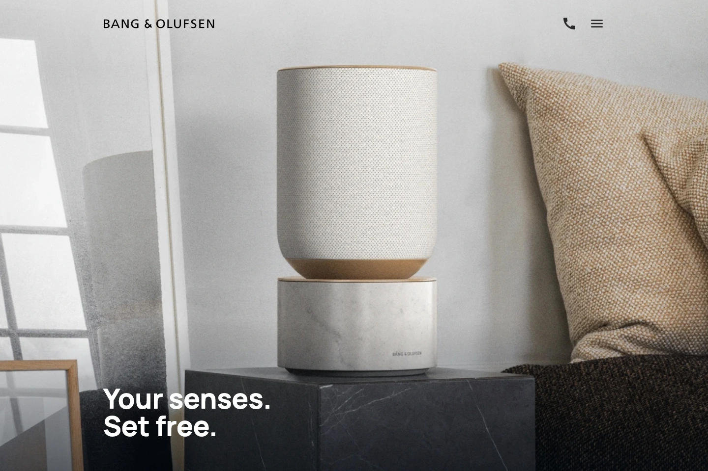
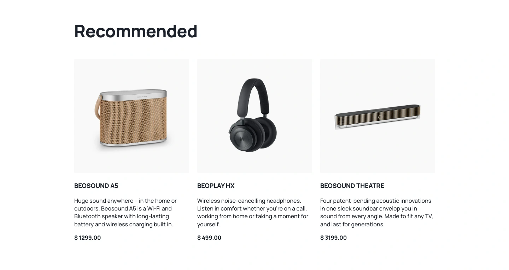
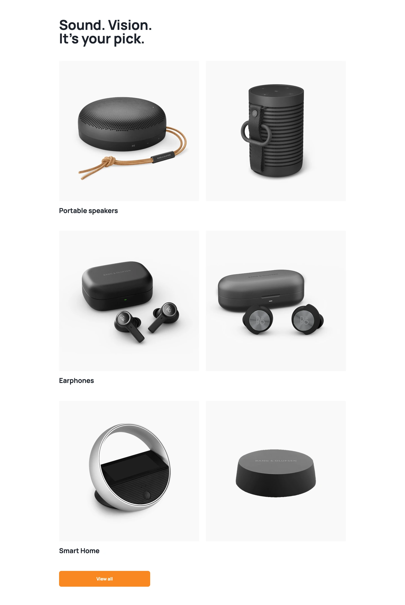
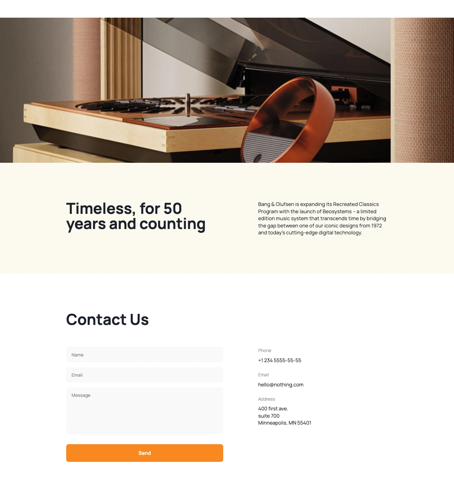
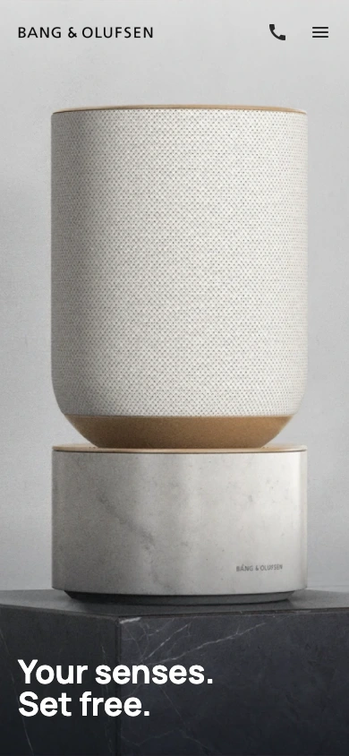
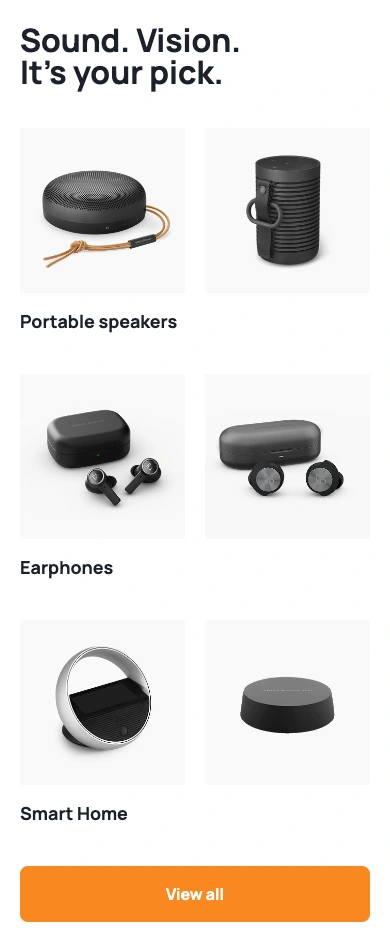
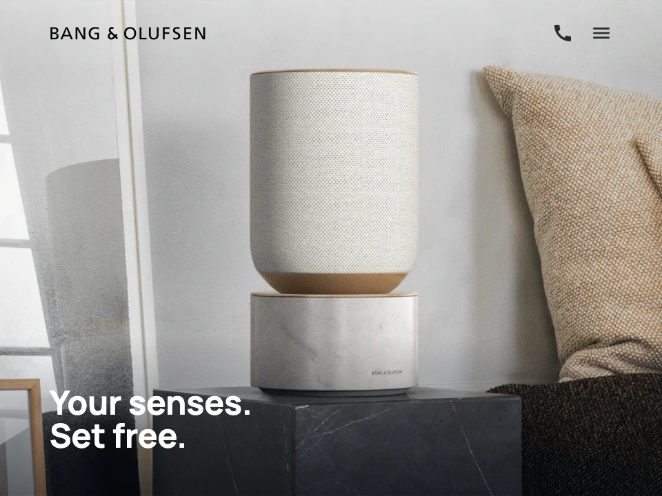
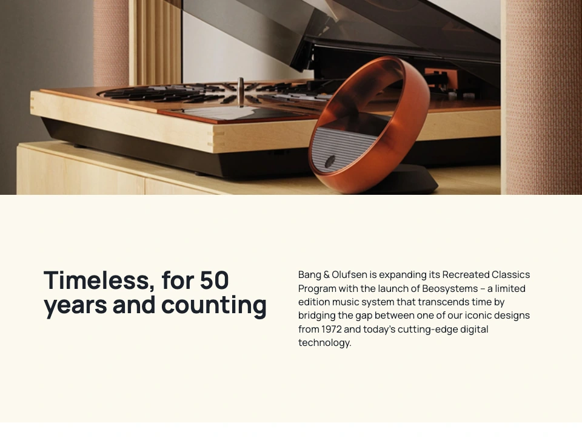

<div align="center">

# Bang & Olufsen

**Your senses. Set free.**

A responsive product landing page inspired by Bang & Olufsen's world of sound and design.
Built with HTML, SCSS, and vanilla JavaScript, with scroll animations powered by AOS.

**HTML5 · SCSS · JavaScript · AOS · Parcel**

[Overview](#overview) · [Screenshots](#screenshots) · [Getting started](#getting-started) · [Project structure](#project-structure)

</div>

[](docs/screenshots/desktop-hero.webp)

<p align="center"><sub>Desktop preview · 1440 × 960</sub></p>

## Overview

Bang & Olufsen is a single-page front-end project that combines warm lifestyle photography, spacious layouts, and a restrained interface with orange accents. The design adapts from compact mobile screens to a full desktop experience, keeping the focus on the products and their materials.

The page showcases Beosound A5, Beoplay HX, and Beosound Theatre, introduces three product categories, and presents the brand's Recreated Classics story before a dedicated contact section.

### Features

- **Responsive layout** — mobile-first styles with dedicated tablet and desktop breakpoints.
- **Product showcase** — three recommended audio products with imagery, descriptions, and prices.
- **Category gallery** — paired photographs for Portable speakers, Earphones, and Smart Home.
- **Responsive images** — product and category photography uses `<picture>` elements to serve different assets by screen size.
- **Full-screen navigation** — a CSS-driven menu with animated transitions, section links, and scroll locking.
- **Scroll animations** — AOS fade-up and fade-right effects reveal products, categories, and brand content once per page load.
- **Brand storytelling** — a full-width photograph and a warm background introduce the Recreated Classics Program.
- **Interactive details** — image hover effects, button states, smooth anchor scrolling, and orange focus outlines on form fields.
- **Contact section** — name, email, and message fields alongside telephone, email, and map links.
- **Finishing touches** — Manrope typography and a sticky photographic footer revealed as the visitor reaches the end of the page.

The contact form is a front-end demonstration. It resets on submission; message delivery is outside the current implementation.

## Screenshots

Eight screenshots across three device layouts: **4 Desktop · 2 Mobile · 2 Tablet**. Click any image to view it at full size. The desktop hero appears above; the remaining seven captures are below.

Section captures show complete content. **Both tablet screenshots are captured in landscape orientation at exactly 960 × 720 px**, using the project's tablet layout.

### Desktop

Captured at a viewport width of **1440 px**.

**Recommended products**

[](docs/screenshots/desktop-products.webp)

<table>
  <tr>
    <th width="50%">Product categories</th>
    <th width="50%">Brand story &amp; contact</th>
  </tr>
  <tr>
    <td valign="top">
      <a href="docs/screenshots/desktop-categories.webp">
        
      </a>
    </td>
    <td valign="top">
      <a href="docs/screenshots/desktop-about-contact.webp">
        
      </a>
    </td>
  </tr>
</table>

### Mobile

Captured at a viewport width of **390 px** in portrait orientation.

<table>
  <tr>
    <th width="50%">Hero</th>
    <th width="50%">Product categories</th>
  </tr>
  <tr>
    <td align="center" valign="top">
      <a href="docs/screenshots/mobile-hero.webp">
        
      </a>
    </td>
    <td align="center" valign="top">
      <a href="docs/screenshots/mobile-categories.webp">
        
      </a>
    </td>
  </tr>
</table>

### Tablet

Both images use a **960 × 720 px landscape viewport**. At this width, the page uses its six-column tablet grid.

<table>
  <tr>
    <th width="50%">Hero · landscape</th>
    <th width="50%">Brand story · landscape</th>
  </tr>
  <tr>
    <td valign="top">
      <a href="docs/screenshots/tablet-hero.webp">
        
      </a>
    </td>
    <td valign="top">
      <a href="docs/screenshots/tablet-about.webp">
        
      </a>
    </td>
  </tr>
</table>

### Responsive design

| Layout  | Screen width      | Grid       | Capture viewport         |
| ------- | ----------------- | ---------- | ------------------------ |
| Mobile  | 320–575 px        | 2 columns  | 390 × 844 px · portrait  |
| Tablet  | 576–1023 px       | 6 columns  | 960 × 720 px · landscape |
| Desktop | 1024 px and above | 12 columns | 1440 × 960 px            |

Breakpoints and colors are defined in [`variables.scss`](src/styles/utils/variables.scss). Shared typography, grid, spacing, and responsive helpers live in [`mixins.scss`](src/styles/utils/mixins.scss). Animation defaults are configured in [`main.js`](src/scripts/main.js), with individual effects declared in the page markup.

## Tech stack

| Technology         | Role                                                            |
| ------------------ | --------------------------------------------------------------- |
| HTML5              | Page structure, responsive pictures, and contact form           |
| SCSS / Sass        | Component styles, variables, reusable mixins, and media queries |
| CSS Grid & Flexbox | Responsive content grids and alignment                          |
| JavaScript         | Animation initialization and page load behavior                 |
| AOS                | Scroll-triggered entrance animations                            |
| Parcel             | Local development, asset processing, and production builds      |
| Cypress            | End-to-end smoke test                                           |
| Prettier           | Source formatting                                               |

Styles follow the **BEM** naming convention and are organized by page section. The interface uses vanilla JavaScript, with AOS as its animation dependency.

## Getting started

### Prerequisites

Install Node.js and npm before continuing.

### Run locally

Clone or download this repository, open its root directory in a terminal, and run:

```bash
npm install
npm start
```

Open **[localhost:3000](http://localhost:3000)** in your browser. Parcel rebuilds the page as you edit the source files.

### Production build

```bash
npm run build
```

The generated site is written to `dist/` and can be served by a static hosting provider. For hosting under a subdirectory, build with a relative asset path:

```bash
npm run build -- --public-url ./
```

### Available scripts

| Command               | Description                                            |
| --------------------- | ------------------------------------------------------ |
| `npm start`           | Start the Parcel development server on port 3000       |
| `npm run build`       | Generate an optimized production build in `dist/`      |
| `npm run format`      | Format HTML, CSS, and SCSS files inside `src/`         |
| `npm test`            | Start the development server and run the Cypress suite |
| `npm run cypress:run` | Run Cypress against an already running local server    |

The included smoke test visits the landing page and checks that its main heading is visible.

## Project structure

```text
.
├── src/
│   ├── index.html             # Landing page markup
│   ├── icons/                 # Navigation icons and favicon
│   ├── images/                # Branding, lifestyle photos, and product assets
│   │   └── products/          # Mobile, tablet, and desktop image variants
│   ├── scripts/
│   │   └── main.js            # AOS initialization and page load behavior
│   └── styles/
│       ├── blocks/            # BEM styles grouped by page section
│       │   ├── header/        # Hero, navigation, menu, and top bar
│       │   ├── main/          # Products, categories, brand story, and contact
│       │   ├── footer/        # Photographic footer
│       │   └── reuse-blocks/  # Shared button styles
│       ├── utils/             # Variables and reusable mixins
│       └── main.scss          # Stylesheet entry point
├── docs/
│   └── screenshots/           # 4 desktop, 2 mobile, and 2 landscape tablet captures
├── cypress/
│   └── integration/
│       └── page.spec.js       # Landing page smoke test
├── cypress.config.js          # Cypress configuration
├── package.json               # Project metadata and npm scripts
├── package-lock.json          # Dependency lockfile
└── LICENSE                    # GNU General Public License v3.0
```

## Author & credits

Developed by **Ivan Tovstukha** as an independent front-end project inspired by Bang & Olufsen's visual identity. Bang & Olufsen branding and product imagery are used to present the design concept.

## License

This project is distributed under the **GNU General Public License v3.0**. See [`LICENSE`](LICENSE) for the full text.
